# Radiation

Eine Strahlungs-Mod im Stil von Fallout für **Minecraft 26.3** (Fabric).

Admins stecken verstrahlte Zonen ab und setzen Strahlungsquellen. Wer in eine hineinläuft, bekommt oben links
einen roten **Strahlungsmesser**, der anzeigt, wie viel RAD/s er gerade aufnimmt, hört einen Geigerzähler knacken
und durchläuft die Stufen der Strahlenkrankheit, bis er bei 1000 Rad stirbt.

Online-Handbuch: https://mchamradio.antwire.net/handbook/radiation/

## Installation mit dem Prism Launcher

1. Lege in Prism eine neue Instanz an (**Add Instance**), wähle Minecraft **26.3** und als Mod-Loader **Fabric**
   (jede aktuelle Loader-Version, mindestens 0.19.5).
2. Öffne in der Instanz **Edit → Mods** und klicke auf **Download mods**. Suche nach **Fabric API** und
   installiere es. Radiation braucht es.
3. Klicke auf **Add file** und wähle `radiation-1.13.0.jar`, oder zieh die Jar auf die Mod-Liste.
4. Starte die Instanz.

Für einen Mehrspieler-Server legst du dieselbe Jar plus Fabric API in den `mods`-Ordner des Servers. Jeder
Spieler braucht die Mod ebenfalls.

Die Mod ist ins Deutsche übersetzt (seit 1.14.0); die Spielsprache folgt der Systemsprache.

## So funktioniert es

| Aufgenommene Rad | Standardstufe                 | Wirkung                                              |
|------------------|-------------------------------|------------------------------------------------------|
| 250              | Leichte Strahlenkrankheit     | Hunger, −1 Herz                                      |
| 500              | Strahlenkrankheit             | Hunger, Schwäche, −2 Herzen                          |
| 750              | Schwere Strahlenkrankheit     | Hunger II, Schwäche II, Langsamkeit, Abbaulähmung, −4 Herzen |
| 1000             | Tod („starb an einer Strahlenvergiftung“) |                                          |

Rad bauen sich nicht von selbst ab (wie in Fallout). Du brauchst RadAway, oder du musst sterben. Beim Tod werden sie zurückgesetzt.

### Der Strahlungsmesser

- **☢ RAD** mit der aktuellen Rate rechts daneben. Er pulsiert rot, solange du Strahlung abbekommst, und wird
  grün, während RadAway Rad aus dir herausspült.
- Ein segmentierter roter Balken von 0 bis zum Maximum, mit einer farbigen Markierung an jeder Krankheitsstufe.
- Aufgenommene / maximale Rad, dein aktueller Schutz (**SCHUTZ %**) und der Name deiner Krankheitsstufe.
- Er erscheint, wenn du bestrahlt oder behandelt wirst, und blendet sich ein paar Sekunden später aus. Mit einem
  Geigerzähler in der Hand ist er immer zu sehen. Solange der F3-Debugbildschirm offen ist, ist er ausgeblendet.

### Gegenstände

| Gegenstand | Was er tut | Rezept |
|------|--------------|--------|
| **Geigerzähler** | Rechtsklick für eine genaue Messung: Umgebungsstrahlung, was du aufnimmst, Schutz, Zustand. In der Hand zeigt er den Messer an. **Schleichen + Rechtsklick auf den Boden oder auf Wasser** misst nur die Kontamination dieses Felds (seit 1.10.1). | Kupferbarren (oben rechts), Eisen / Glasscheibe / Eisen, gelber Farbstoff / Redstone / gelber Farbstoff |
| **Dekontaminationssprüher** | Rechtsklick auf Wasser füllt ihn, Rechtsklick gedrückt halten auf verstrahltem Boden wäscht ihn ab (seit 1.10.0, siehe [Verstrahlter Boden und verstrahltes Wasser](#verstrahlter-boden-und-verstrahltes-wasser)) | Haken (oben rechts), Eisen / Kolben / Eisen, gelber Farbstoff / Eimer / gelber Farbstoff |
| **Feldflasche** | Fünf Portionen Wasser: Rechtsklick auf Wasser füllt sie, Rechtsklick gedrückt halten trinkt eine (seit 1.11.0, siehe [Durst](#durst-und-trinkwasser)) | Eisenklumpen (oben Mitte), Leder / Leder an den Seiten, drei Eisenbarren unten |
| **Plastikflasche**, **Wasser**, **Schmutzwasser**, **Aufbereitetes Wasser** | Eine an Wasser gefüllte Plastikflasche enthält Wasser (Schmutzwasser, wenn das Wasser verstrahlt ist); der Wasseraufbereiter füllt sie mit aufbereitetem Wasser. Beides trinkt man wie einen Trank (eine Portion), die leere Flasche bleibt (seit 1.12.0) | Schleimball (oben Mitte), getrockneter Seetang an den Seiten und unten entlang → 4 |
| **Wasseraufbereiter** | Eine 230-V-Maschine, die Rohwasser zu sauberem Wasser macht (seit 1.11.0, siehe [Durst](#durst-und-trinkwasser)) | Eisen / Eimer / Eisen, Glas / Holzkohle / Glas, Kupferbarren / Redstone / Kupferbarren |
| **RadAway** | Entfernt über 10 Sekunden 150 Rad | Formlos: Glasflasche + getrockneter Seetang + Leuchtbeeren + Zucker |
| **Rad-X** | Hält 4 Minuten lang 50 % der einwirkenden Strahlung ab | Formlos: Papier + Amethystscherbe + Zucker + oranger Farbstoff → 2 |
| **Schutzhaube / Strahlenschutzanzug / Schutzanzughose / Schutzstiefel** | Jedes Teil hält 22,5 % ab (der komplette Satz 90 %) | Geformt wie Lederrüstung, aus Leder und gelber Wolle (die Haube hat ein Visier aus einer Glasscheibe) |
| **Atommüllfass** | Ein Block, der seine Umgebung bestrahlt (standardmäßig 6 rad/s, Radius 6). Es leuchtet und tropft grüne Partikel. Nur im Kreativ-Modus bzw. für Admins. | keins |

Schutz durch Rüstung und Rad-X addiert sich, standardmäßig gedeckelt bei 95 %.

Feste Blöcke zwischen dir und einer **Punktquelle** schlucken Strahlung. Standardmäßig nimmt jeder Block 35 % weg,
also hilft es, sich hinter einer dicken Wand zu verstecken. Zonen sind gleichmäßig, gegen sie kann man sich nicht abschirmen.

## Bunkerblöcke

Version 1.2.0 bringt alles, was du für einen Atombunker im Stil von Fallout brauchst.

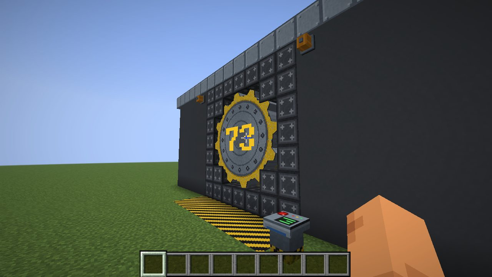

| Block | Was er tut |
|-------|--------------|
| **Bunkertor** | Das große Zahnradtor für eine runde 5×5-Öffnung. Setz es in die Mitte der Öffnung, mit der Vorderseite nach außen. Es schließt auf beiden Seiten bündig mit der Wand ab, in einem Stahlkragen, der die Öffnung um das Zahnrad herum füllt. Ein **Schraubarm** dahinter fährt aus, schraubt sich ins Zahnrad, zieht es in den Bunker zurück und lässt los; dann rollt das Zahnrad zur Seite. Beim Schließen läuft alles umgekehrt. Die ganze Zeit über tönt ein Alarmhorn. Es ist explosionsfest. |
| **Bunkertor-Konsole** | Ein Sockel mit einem großen Knopf: öffnet oder schließt das nächste Bunkertor im Umkreis von 16 Blöcken. Ein Bunkertor schaltet auch bei einem Redstone-Impuls um. |
| **Bunker-Alarmleuchte** | Eine drehende orange Warnleuchte. Sie dreht sich und leuchtet, während sich ein Bunkertor im Umkreis von 16 Blöcken öffnet oder schließt. Lässt sich an jeder Wand, auf dem Boden oder an der Decke anbringen. |
| **Bunker-Schiebetür** | Eine zwei Blöcke hohe Stahltür, die nach oben in die Wand darüber gleitet. Türen, die nebeneinander in derselben Wand stehen, öffnen sich gemeinsam, so kannst du breitere Durchgänge bauen. Öffnet per Hand oder Redstone. |
| **Bunker-Wandplatte**, **Gestreifte Bunker-Wandplatte**, **Bunker-Rohrplatte** | Genietete Stahlwände: schlicht, mit dem blau-gelben Streifen und mit Rohren. |
| **Bunker-Bodenplatte**, **Bunker-Bodengitter** | Riffelblech und durchsichtiges Gitter. |
| **Warnstreifen**, **Bunkertor-Rahmen** | Gelb-schwarze Warnstreifen; schwere Rahmenblöcke für die Toröffnung. |
| **Bunker-Lichtpaneel**, **Blaue / Gelbe / Weiße Neonröhre** | Flache Lichtpaneele und Neonröhren für Wände, Böden und Decken. |

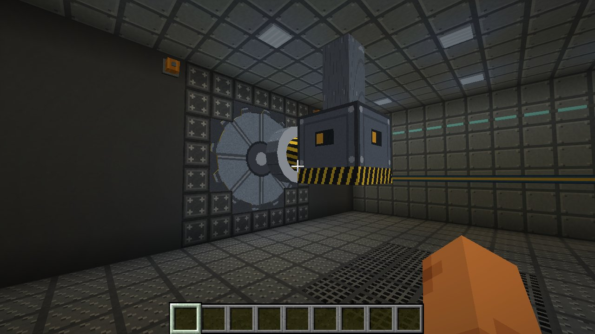

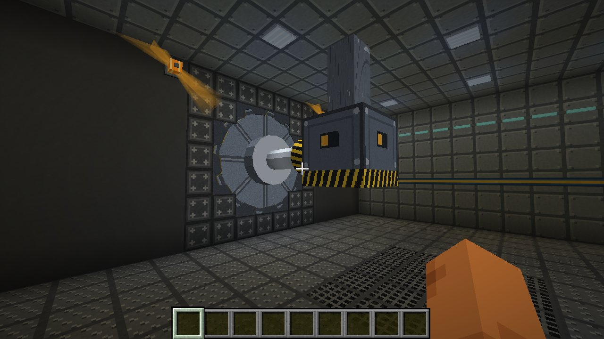

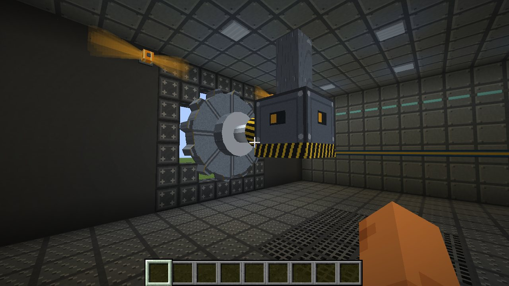

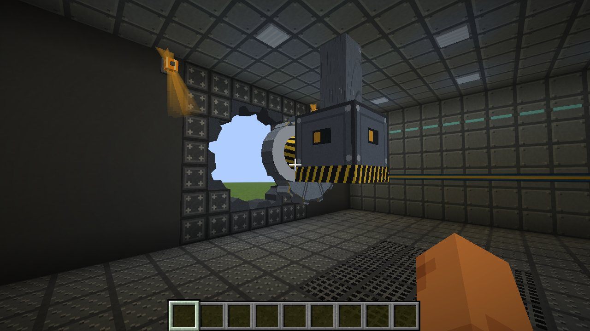

**Platz, den das Tor braucht.** Das Tor ist 5 Blöcke breit. Dahinter (im Bunker) muss der Raum frei bleiben: **7 Blöcke tief** für den Schraubarm, **4 Blöcke über der Mitte des Tors** für die Deckenhalterung des Arms und **8 Blöcke zur Seite**, zu der das Tor rollt. Die Ecken des 5×5-Quadrats bleiben massiv; nimm dort Bunkertor-Rahmen.

**Nummer und Rollrichtung.** Schleiche und benutze das Tor, um die aufgemalte Nummer (0 bis 999) einzustellen und zu wählen, zu welcher Seite es rollt. Das können nur Operatoren und Spieler im Kreativ-Modus.

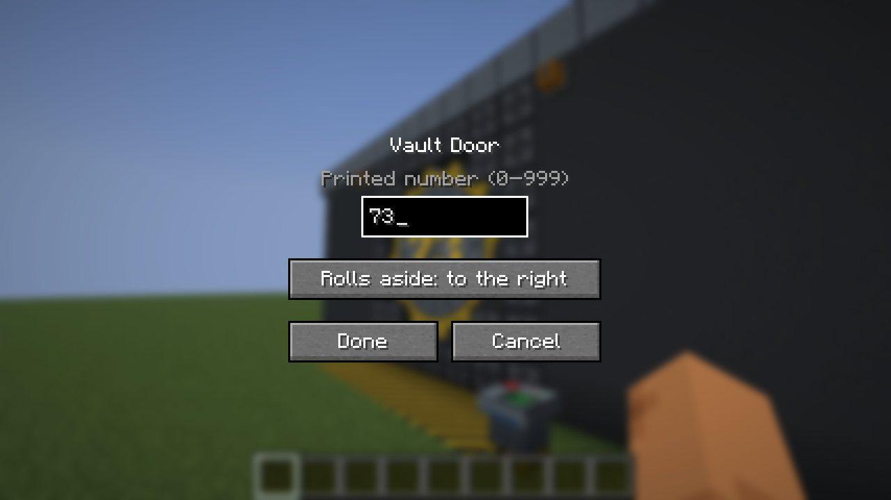

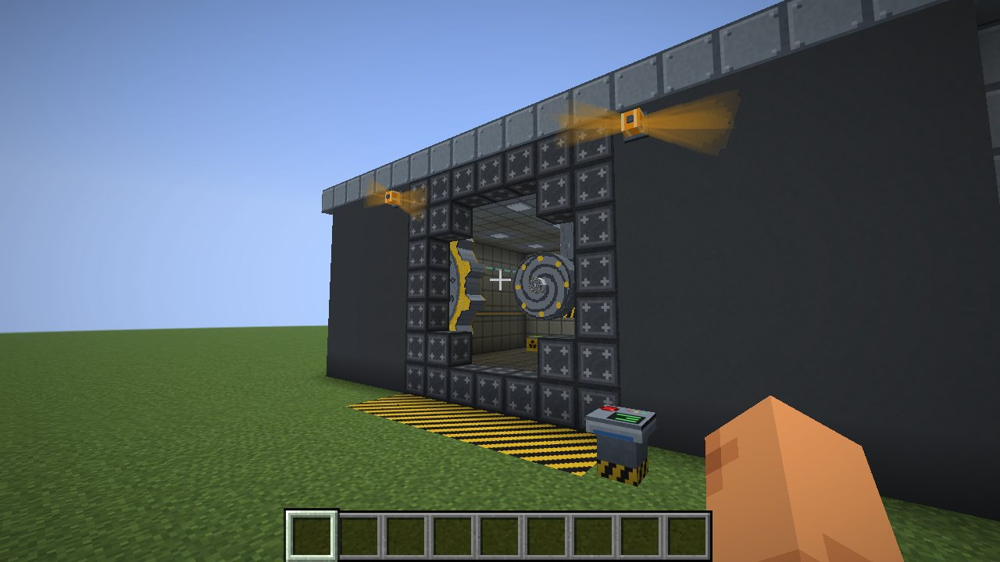

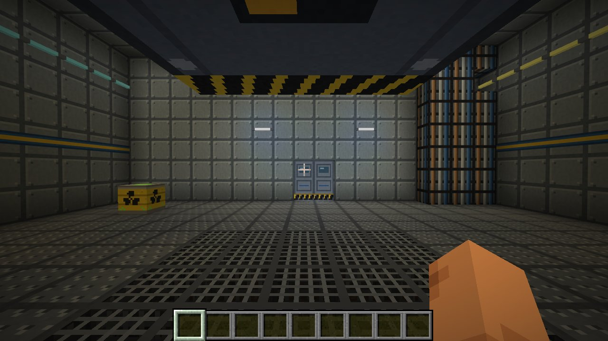

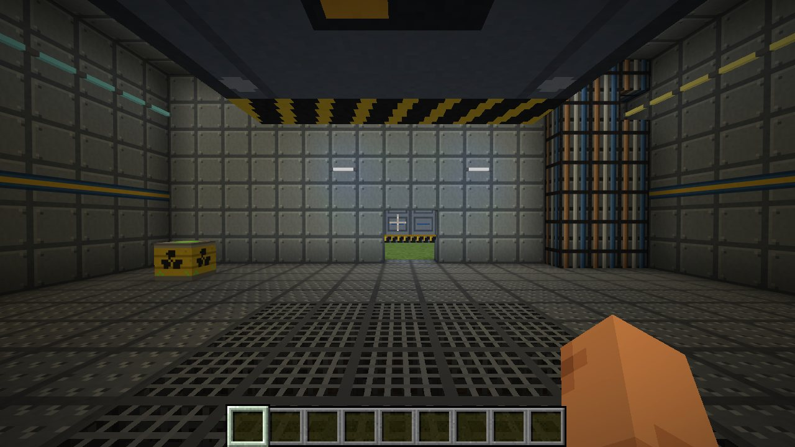

### Bunker-Rezepte

| Gegenstand | Rezept |
|------|--------|
| Bunkertor | 8 Eisenblöcke um einen Redstone-Block |
| Bunkertor-Konsole | Steinknopf oben, Glasscheibe / Redstone / Glasscheibe, 3 Eisenbarren |
| Bunker-Alarmleuchte | Glowstonestaub, orange gefärbte Glasscheibe / Redstone / orange gefärbte Glasscheibe, Eisenbarren |
| Bunker-Schiebetür ×2 | 5 Eisenbarren und ein Kolben (Eisen, Eisen / Kolben, Eisen / Eisen, Eisen) |
| Bunker-Wandplatte ×8 | 8 glatter Stein um einen Eisenbarren |
| Gestreifte Bunker-Wandplatte ×2 | 2 Wandplatten, gelber Farbstoff, blauer Farbstoff |
| Bunker-Rohrplatte | Wandplatte und ein Kupferbarren |
| Bunker-Bodenplatte | Wandplatte und grauer Farbstoff |
| Bunker-Bodengitter ×4 | 4 Eisengitter |
| Warnstreifen | Wandplatte, gelber Farbstoff, schwarzer Farbstoff |
| Bunkertor-Rahmen ×4 | 2 Eisenbarren und 2 Obsidian, diagonal |
| Bunker-Lichtpaneel ×2 | Eisenklumpen, Glowstone, Eisenklumpen |
| Neonröhre ×2 | Glasscheibe, Glowstonestaub und blauer, gelber oder weißer Farbstoff |

## Beton und Abschirmung

Die Abschirmung hängt vom Material ab. Jeder Block zwischen einer Strahlungsquelle und dir schluckt einen Teil
der Strahlung:

| Material | Schluckt pro Block | Übrig nach 3 Blöcken |
|---|---|---|
| **Schwerbeton**, Eisen-/Gold-/Netheritblöcke, Obsidian, Bunkertore | 97 % | 0,003 % |
| **Stahlbeton**, jeder farbige Beton, Bunkerwände | 90 % | 0,1 % |
| Andere feste Blöcke | 35 % | 27 % |
| Wasser | 30 % | 34 % |
| Luft, Glasscheiben, Laub und andere durchsichtige Blöcke | nichts | |

Beton schirmt zuverlässig ab (seit 1.4.0; vorher ließ er pro Block 45 % durch): Jeder Block nimmt 90 % weg,
eine Wand von ein paar Blöcken Dicke hält also praktisch alles auf. Gemessen in der Testwelt, ein Strahler mit
1000 rad/s auf einen Meter, 6 m entfernt: 26,8 rad/s im Freien, 2,7 hinter einem Block Beton, 0,27 hinter
zweien, 0,027 hinter dreien, 0,0027 hinter vieren. (Echter Beton ist noch besser: Ein Meter davon lässt etwa
1/10.000 der Gammastrahlung von Spaltprodukten durch.)

| Block | Rezept | |
|---|---|---|
| **Stahlbeton** | 8 grauer Beton um 1 Eisenbarren → 8 | Explosionswiderstand 1200 (wie Obsidian): Explosionen zerstören ihn nicht |
| **Schwerbeton** | 5 Stahlbeton + 4 Roheisen → 5 | Explosionswiderstand 1200, die beste Abschirmung |

Beide brauchen eine Diamantspitzhacke. Sie sind das Material für Bunker, Tresore und Reaktorgebäude (die
Reaktoren der Fission-Mod können nicht durch genug davon hindurchsprengen). Mit den Tags `radiation:shielding_concrete`
und `radiation:shielding_heavy` können Datenpakete und andere Mods eigene Blöcke hinzufügen.

## Was Strahlung mit dem Land macht

Seit 1.4.0 schädigt Strahlung Pflanzen, Boden und Tiere, nicht nur Spieler. Alles hängt von der Dosisleistung an
der Stelle ab, also schützen Beton, Wasser und Erde ein Feld genau so, wie sie dich schützen.

| Dosisleistung (Standard) | Was passiert |
|---|---|
| 0,01 rad/s | Feldfrüchte, Setzlinge, Melonen, Kürbisse, Beeren, Zuckerrohr, Kakteen, Bambus und Netherwarzen wachsen halb so schnell |
| 0,1 rad/s | ...nur noch mit einem Zehntel ihrer Geschwindigkeit (dazwischen ändert es sich allmählich) |
| 0,3 rad/s | Laub stirbt ab und fällt: Bäume stehen kahl |
| 1 rad/s | Feldfrüchte, Blumen, Gras, Farne und Setzlinge sterben ab; wo sie stehen können, bleiben tote Büsche zurück |
| 2 rad/s | Gras, Podsol, Moos und Ackerboden sterben zu nackter Erde ab |
| 25 rad/s | Erde jeder Art wird zu Sand: Im Boden lebt nichts mehr |
| 0,01 rad/s | Tiere und Dorfbewohner nehmen Rad genau wie Spieler auf (seit 1.6.0): dieselben Krankheitsstufen und Wirkungen (Hunger ab 250, Schwäche ab 500, Langsamkeit ab 750), derselbe Anteil ihrer Gesundheit geht verloren, tot bei 1000. Untote kümmert das nicht. |

Ist das realistisch? Ungefähr, nur zeigen Pflanzen es langsamer als hier: 0,01 rad/s sind 8,6 Gy am Tag, das
hemmt Getreide innerhalb von Tagen; die Kiefern bei Tschernobyl (der Rote Wald) starben nach ein paar hundert Gray,
Gräser und Kräuter vertragen ein Mehrfaches. Eine Rate von 1 rad/s (36 Gy pro Stunde) tötet die meisten Pflanzen innerhalb eines Tages.

| Eine Quelle mit 40 rad/s nach einer Weile | Weizen bei 0,3, 0,1 und 0 rad/s, gleiche Zeit |
|---|---|
| 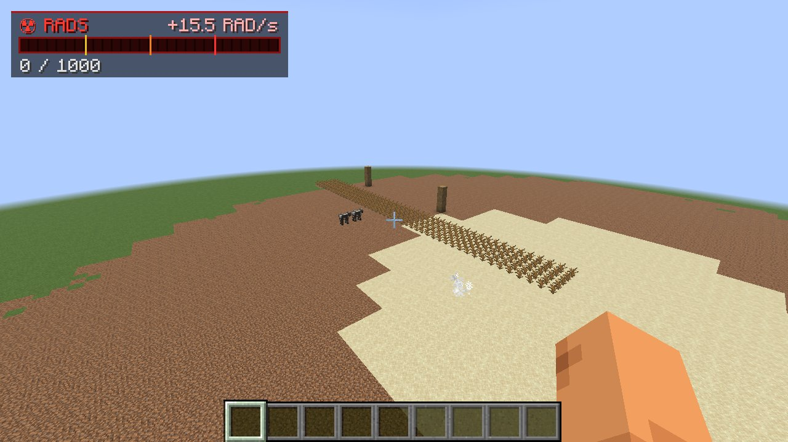 | 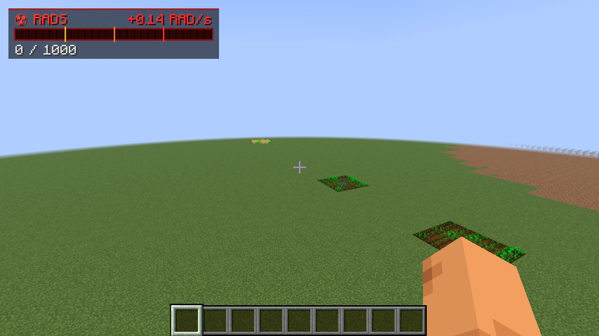 |

Nur das Land in der Nähe von Strahlung wird betrachtet, ein paar Oberflächenblöcke pro Chunk und Sekunde. Das kostet
wenig, und Veränderungen kommen über ein paar Minuten statt auf einmal. Alle Schwellen stehen in der Konfiguration (`ecology`).

## Verstrahlte Nahrung

Seit 1.7.0 **hat jede Nahrung eine Kontamination**: die Rad, die du aufnimmst, wenn du sie isst. Der Tooltip zeigt sie
in Rot direkt unter dem Namen - **+20 Rad** - bei jeder verstrahlten Nahrung und bei dem, woraus Nahrung gemacht wird
(Weizen, Zucker, Eier, Milch, Kürbisse... das Item-Tag `radiation:contaminable`); saubere Nahrung zeigt nichts. Rüstung und
Rad-X helfen nicht: Was du isst, ist in dir.

Nahrung wird verstrahlt
- **auf dem Feld**: Eine Feldfrucht nimmt bei der Ernte die Strahlung an der Pflanze auf, wie Getreide, Milch und Pilze
  rund um Tschernobyl: 20 Rad pro Stück für jedes rad/s. Weizen von einem Feld mit 0,25 rad/s: 5 Rad pro Garbe. Samen
  bleiben sauber. Dasselbe gilt für Beeren, Äpfel aus Laub, Melonen, Kürbisse, Kakao, Pilze und Zuckerrohr.
  **Eine Feldfrucht merkt es sich** (seit 1.9.0): Die stärkste Strahlung, der eine wachsende Frucht je ausgesetzt war,
  bleibt bis zur Ernte an ihr, also ist die Ernte auch dann verstrahlt, wenn der Fallout bis dahin abgeklungen oder die
  Wolke vorübergezogen ist. Ein Feld, über das die Wolke mit 0,5 rad/s zog, gibt noch Wochen später Weizen mit 6,7 Rad.
  Nur eine frisch gesäte Frucht beginnt sauber.
- **im Tier**: Fleisch, Eier und Ähnliches von einem bestrahlten Tier tragen ein Zehntel seiner Rad.
- **im Lager**: Nahrung in einer Truhe, einem Fass, einem Ofen, einem Trichter... oder auf dem Boden, wo Strahlung
  hinkommt, nimmt 0,005 Rad pro Stück für jedes Rad auf, dem sie ausgesetzt ist: eine Stunde bei 1 rad/s macht 18 Rad.
  **Nahrung in deinem Inventar nimmt nichts mehr auf** - trag sie aus der Zone.
- **durch Verarbeitung**: Was aus verstrahlter Nahrung gemacht wird, ist ebenfalls verstrahlt. Beim Herstellen wird die
  Kontamination aller Zutaten auf das Ergebnis verteilt - drei Garben Weizen mit je 5 Rad backen ein Brot mit 15 Rad -
  und Kochen behält sie bei: Ein rohes Steak mit 12 Rad ist ein gebratenes Steak mit 12 Rad.

**Jede Art von Strahlung zählt** (seit 1.8.0): Fallout, der Ground Zero einer Detonation, Zonen, Wolken darüber, ein
brennender Reaktorkern und die Gammastrahlung strahlender Blöcke (Corium, abgebrannter Brennstoff) und Atommüllfässer. Eine
Truhe voller Brot neben einem zerstörten Kern wird verstrahlt. (1.7.2 zählte nur Radioaktivität, die auf dem Boden lag;
`food.notContaminating` und `food.gammaContaminates = false` bringen das zurück.)

**Eine Nahrung trägt höchstens 4 Rad pro Nährwertpunkt** (`food.radsPerNutrition`): ein Brot (5) höchstens
**20 Rad**, ein Steak (8) 32, ein Apfel (4) 16, rohes Rindfleisch (3) 12, eine Melonenscheibe (2) 8. Was keinen eigenen
Nährwert hat, zählt mit seinem Anteil an dem, wozu es verarbeitet wird, damit die Obergrenze über die Verarbeitung hinweg
gilt: Weizen ein Drittel eines Brots (6,7 Rad), ein Kürbis 16, ein Ei 8, Zucker 4, ein Eimer Milch 16, ein Pilz 12 (ein halber
Eintopf), ein Heuballen 60, ein Kuchen 56.

**Nahrung bleibt verstrahlt.** Die Strahlung klingt im Land ab (siehe unten), aber nie in Nahrung, die sie aufgenommen
hat: Eine Garbe, ein Brot oder ein Steak behält seine Rad für immer.

Ernten werden auf ein paar Stufen gerundet (0,1, 0,2, 0,3, 0,5, 1, 2, 3, 5, 10, 20...), damit sie sich stapeln.

| Verstrahltes Brot | ...und ein Steak von einer bestrahlten Kuh |
|---|---|
| 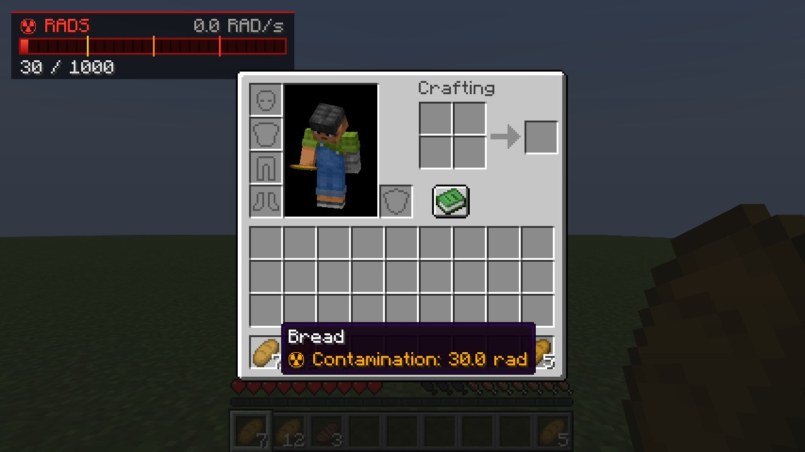 | 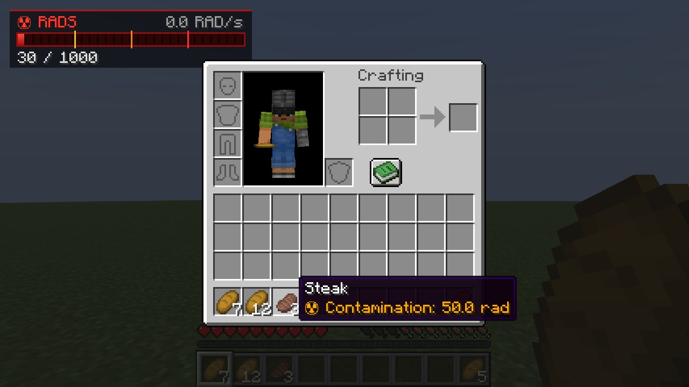 |

In einem Test (1.8.0): Weizen von einem Feld mit 0,53 rad/s kam mit der Obergrenze heraus, 6,7 Rad pro Garbe, und das
daraus gebackene Brot mit 20 Rad; eine Kuh mit 400 Rad gab Rindfleisch an der Obergrenze von 12 Rad, und der Ofen machte
daraus gebratenes Rindfleisch mit 12 Rad; eine Minute neben einer Falloutquelle mit 1,9 rad/s brachte das Brot in einer
Truhe, den Weizen daneben und einen Apfel auf dem Boden auf je 5,8 Rad (bei der 10-fachen normalen Aufnahme), eine Truhe
neben einem strahlenden Block mit 2 rad/s bekam 6 Rad in ihr Brot, während das Brot im Inventar des Spielers sauber blieb;
ein auf 30 Rad gesetztes Brot zu essen brachte den Spieler von 0 auf 20 Rad.

## Verstrahlter Boden und verstrahltes Wasser

Seit 1.10.0 **bleibt Radioaktivität, die herunterkommt, im Boden**, Feld für Feld: Jede 4x4-Säule hat in der Höhe, in
der sie gelandet ist, ihre eigene Kontamination, also sind Fallout auf einem Dach und eine Verschüttung auf dem Boden darunter
getrennt. Fallout aus Wolken landet dort (früher war es eine große Quelle pro 48-Block-Quadrat; Welten von vor 1.10 werden
beim ersten Start umgewandelt), ebenso Spaltprodukte, die herumliegen oder in einer gewöhnlichen Truhe aufbewahrt werden
([Fission](https://github.com/Lamisator/fission) 1.5.0). Die Dosisleistung einen Meter über einer gleichmäßigen Fläche
ist ihr Wert; benachbarte Felder im Umkreis von ein paar Blöcken zählen weniger, Wände, Dächer und der Boden dazwischen
schirmen ab, und weiter oben wird es schwächer. Fallout klingt ab wie bisher; **dauerhafte Kontamination** (verschüttete
Spaltprodukte) hat eine Halbwertszeit von 3650 Minecraft-Tagen (`contamination.lastingHalfLifeDays`)
- praktisch bleibt sie, bis sie abgewaschen wird.

**Auch Wasser wird verstrahlt.** Fallout, der auf einen See oder Fluss fällt, geht ins Wasser, ebenso das Abwasser einer
Dekontamination, und ein See vermischt sich langsam: Alle 20 Sekunden gibt ein verstrahltes Feld ein Zehntel seines
Überschusses an die benachbarten Wassersäulen ab (`contamination.waterMixing`). Daneben zu stehen ist harmlos - Wasser
schirmt ab -, aber **darin zu schwimmen nicht**: Im Wasser bekommst du seine volle Dosisleistung ab, und mit dem Kopf unter
Wasser schluckst du etwas davon, was noch einmal zählt (`contamination.swallowedFactor`; ein Schutzanzug hilft dagegen
nicht). In einem Test gaben 10 Sekunden Tauchen in einem Teich mit 0,62 rad/s 13 Rad.

### Dekontaminationssprüher

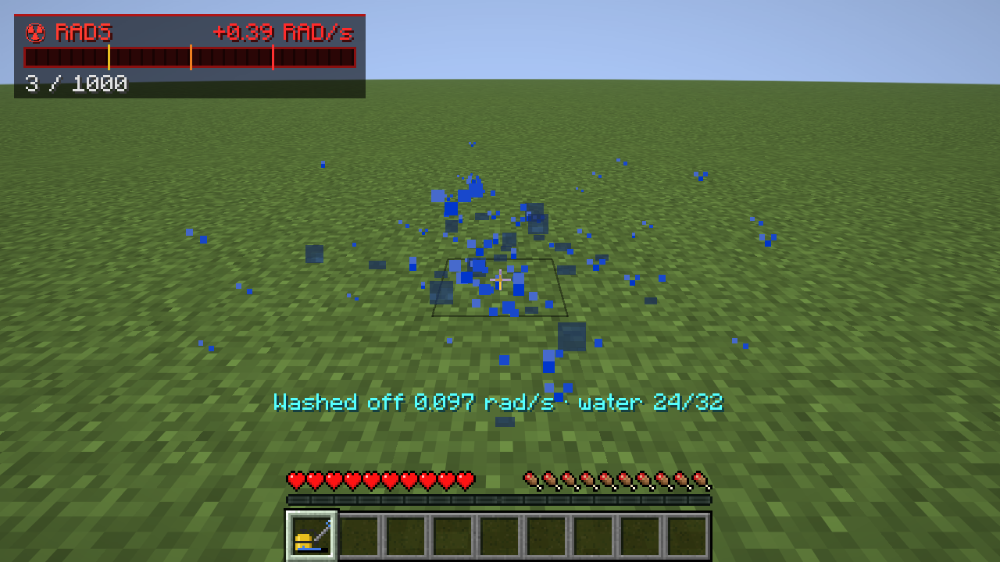

Ein Drucksprüher, um Radioaktivität vom Boden abzuwaschen. **Rechtsklick auf Wasser füllt ihn** (32 Stöße,
`contamination.sprayerTank`; der Balken zeigt, was übrig ist), dann **halte Rechtsklick auf dem verstrahlten Boden**:
Jede Viertelsekunde wäscht ein Stoß 25 % (`contamination.sprayWashes`) von den Feldern im Umkreis von 2,5 Blöcken um
die Stelle (`contamination.sprayRadius`) in dieser Höhe ab. Die Aktionsleiste zeigt, wie viel abging. 30 % davon laufen
ins nächste Wasser im Umkreis von 16 Blöcken, das dadurch seinerseits verstrahlt wird (`contamination.runoffToWater`); der
Rest geht in den Abfluss. In einem Test brachten fünf Sekunden Sprühen eine Wiese an der besprühten Stelle von 0,76 auf
0,29 rad/s (der Rest kommt von den Feldern drumherum). Rezept: Eisenbarren, ein Kolben, ein Eimer, ein Haken (der Abzug)
und gelber Farbstoff.

**Messen.** Der Messer des Geigerzählers zeigt alles, was dich erreicht, den Boden eingeschlossen. Um den Boden
selbst zu messen, **schleiche und mach mit dem Geigerzähler einen Rechtsklick auf den Boden (oder Wasser)** (seit 1.10.1):
Er misst das 4x4-Feld, auf das du zeigst - seine Dosisleistung einen Meter über einer gleichmäßigen Fläche davon, aufgeteilt
in Fallout (klingt ab) und dauerhafte Kontamination (verschüttete Spaltprodukte, bleibt bis zum Abwaschen) - und das
stärkste Feld daneben, egal was sonst ringsum strahlt. „Sauber“ heißt, in diesem Feld ist nichts. Auf der Webkarte von
[Atlas](https://github.com/Lamisator/mc_atlas) zeigt „Contaminated ground & water“ in der Strahlungsebene jedes Feld.

`/radiation contamination [radius]` zeigt die Felder in deiner Nähe (das stärkste mit seiner Position),
`/radiation contamination add <pos> <rad/s>` verstrahlt ein Feld, `/radiation contamination clear <radius>` entfernt sie.

## Durst und Trinkwasser

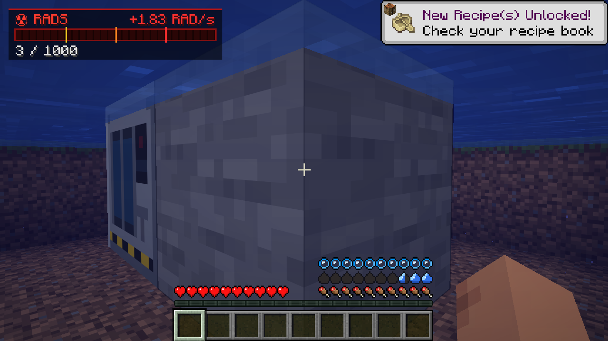

Seit 1.11.0 musst du **trinken**. Zehn Tropfen über der Hungerleiste zeigen deinen Durst: 20 Punkte, wie beim Hunger. Er
sinkt von selbst (eine volle Leiste hält 30 Minuten, wenn du nur herumstehst, `thirst.idleSecondsPerPoint` 90), schneller
bei allem, was hungrig macht - Rennen, Springen, Schwimmen, Kämpfen, Heilen (`thirst.exhaustionPerPoint`: 6 von Vanillas
Nahrungserschöpfung pro Punkt) - und in heißen Biomen noch einmal halb so schnell: Wüste, Savanne, Tafelberge, der Nether
(`thirst.hotBiomeFactor`). Bei 3 Tropfen oder weniger zittert die Leiste und **du kannst nicht mehr sprinten**; ist sie leer,
bist du **ausgetrocknet** und verlierst alle 4 Sekunden ein halbes Herz - auf Einfach bis auf 5 Herzen, auf Normal bis auf
ein halbes Herz, auf Schwer bis zum Tod („ist verdurstet“). Spieler im Kreativ- und Zuschauermodus bekommen keinen Durst, auf
Friedlich füllt sich die Leiste wieder, und nach dem Respawn ist sie wieder voll. `thirst.enabled` false schaltet das alles ab.

| Getränk | Punkte |
|-------|--------|
| Ein Schluck aus einem Wasserblock: **Rechtsklick auf Wasser mit leerer Hand** (zweimal pro Sekunde, solange gedrückt) | 2 |
| Eine **Wasserflasche** (an Wasser gefüllte Glasflasche, wie in Vanilla) - und jeder andere Trank, Milch | 6 (eine Portion) |
| **Wasser**, **Schmutzwasser** oder **Aufbereitetes Wasser** in einer Plastikflasche | 6 (eine Portion) |
| Eine Portion aus einer **Feldflasche** (fasst fünf) | 6 |
| Honig, Suppen und Eintöpfe | 3 |

**Wasser kann verstrahlt sein.** Wasser, das dort geschöpft wird, wo Strahlung ist - ein verstrahlter See oder Fluss,
Fallout, ein Reaktor in der Nähe -, trägt sie in sich, wie verstrahlte Nahrung: 10 Rad pro Portion für jedes rad/s dort
(`thirst.waterUptake`, höchstens 50, `thirst.maxRadsPerServing`). Eine dort gefüllte Flasche oder Feldflasche zeigt es in Rot
unter ihrem Namen („+9.7 Rad“), und du nimmst es beim Trinken auf („Verstrahltes Wasser: +9.7 Rad“). Ein Schluck direkt aus
dem Wasser trägt ein Drittel einer Portion. In einem Test gab ein Teich mit 0,96 rad/s Fallout 9,7 Rad pro Flasche; vier
Schlucke daraus brachten einen durstigen Spieler von 5 auf 13 Punkte und gaben 13 Rad. Eine Feldflasche nachzufüllen mischt
das alte Wasser mit dem neuen.

### Plastikflaschen: Wasser, Schmutzwasser und Aufbereitetes Wasser

Seit 1.12.0. **Mach mit einer leeren Plastikflasche einen Rechtsklick auf Wasser**. Der Name sagt, was drin ist (seit 1.13.0):

- **Wasser** (weißer Deckel, klar): aus einem See oder Fluss ohne Strahlung - ungefiltert, aber harmlos.
- **Schmutzwasser** (grauer Deckel, trübes Braun): jedes Wasser, das Strahlung trägt - dort geschöpft, wo Strahlung ist,
  oder Wasser jeder Art, das sie im Lager aufgenommen hat. Es gibt seine Rad ab, wenn du es trinkst.
- **Aufbereitetes Wasser** (blauer Deckel, Etikett): Nur der Wasseraufbereiter stellt es her. Wo Strahlung hinkommt, wird
  auch es beim Lagern zu Schmutzwasser.

Alle stapeln sich bis 16 (Flaschen mit unterschiedlicher Kontamination stapeln sich nicht), werden wie ein Trank getrunken
(eine Portion, 3 Tropfen) und geben die leere Flasche zurück. Rezept: Ein Schleimball und fünf getrocknete Seetang in
Flaschenform ergeben 4.

**Gelagertes Wasser nimmt Strahlung auf wie Nahrung** - auch in Flaschen und Feldflaschen. Wasser in einer Truhe, einem
Fass oder einem anderen Behälter, wo Strahlung es erreicht, oder dort auf dem Boden liegend, nimmt sie langsam auf
(`food.storageUptake`, 0,005 Rad pro Rad Belastung: eine Stunde bei 1 rad/s ergibt 18 Rad), sodass selbst aufbereitetes
Wasser in einem Lager unter Fallout radioaktiv wird. Im Inventar getragen nimmt es nichts mehr auf. Sichere Lagerung:

- ein Lager, das die Strahlung nicht erreicht - hinter Beton, unter der Erde (die Aufnahme folgt der Dosisleistung, wo der
  Behälter steht);
- ein Behälter im Block-Tag **`radiation:sealed_storage`**, der Nahrung und Wasser sauber hält, wo immer er steht.
  Standardmäßig ist das der Wasseraufbereiter selbst; ein Datenpaket kann weitere Behälter hinzufügen.

In einem Test trugen zwei aufbereitete Wasser in einer Truhe bei 0,5 rad/s nach 20 Sekunden je 0,56 Rad (bei zehnfacher
Standardaufnahme), während die zwei im Inventar des Spielers sauber blieben.

### Feldflasche

Fünf Portionen (`thirst.canteenServings`). **Rechtsklick auf Wasser** füllt sie, **Rechtsklick gedrückt halten** trinkt eine
Portion (nicht, wenn du keinen Durst hast). Der Balken darunter zeigt, wie voll sie ist - blau für sauberes Wasser, grün für
verstrahltes - und der Tooltip, wie viele Portionen übrig sind. Rezept: ein Eisenklumpen (der Deckel), zwei Leder (der Gurt)
und drei Eisenbarren.

### Wasseraufbereiter

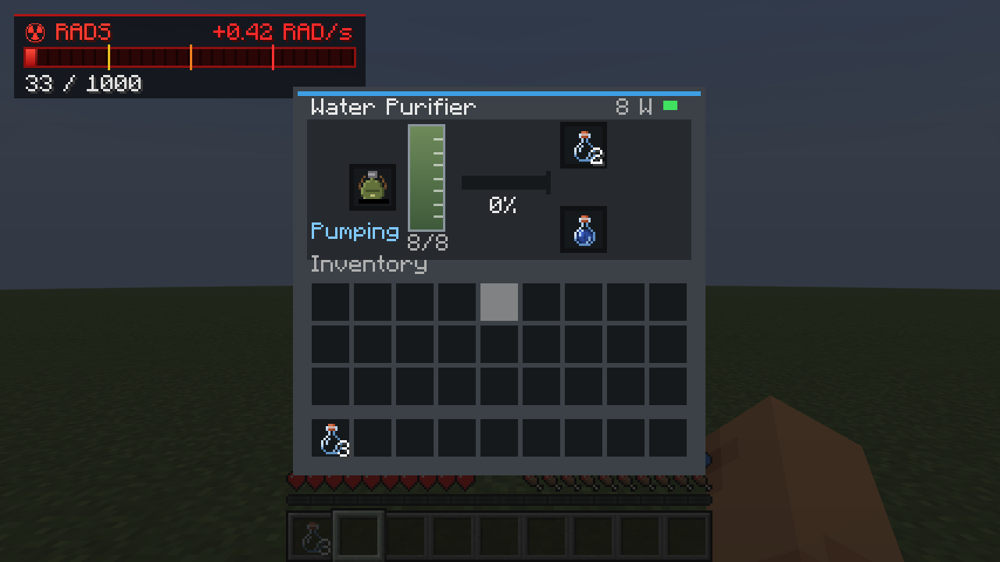

Macht aus Rohwasser sauberes Wasser. Die Strahlung bleibt in seinen Filtern (die nie gewechselt werden müssen).

- **Rohwasser** kommt in seinen Tank (8 Portionen, `purifier.tankServings`): Leg Wasserflaschen oder Feldflaschen in den
  linken Slot - es wird jeweils eine Portion eingefüllt, und die leere Flasche oder Feldflasche wandert in den
  Behälter-Slot, um mit sauberem Wasser gefüllt zu werden - oder lass ihn **aus einem Wasserblock pumpen**, der seine Seiten
  oder seine Unterseite berührt (etwa drei Portionen pro Sekunde, `purifier.pumpSecondsPerServing`). „Pumpt“ auf dem
  Bedienfeld zeigt das an. Eingefülltes Wasser hat Vorrang: Ist der Tank voll mit gepumptem Wasser, geht eine gepumpte
  Portion zurück, um Platz zu machen.
- **Leere Flaschen und Feldflaschen** kommen in den Slot oben rechts. Jede aufbereitete Portion füllt eine Flasche, die im
  Slot unten rechts herauskommt, oder eine Feldflasche, die an Ort und Stelle gefüllt wird und in die Ausgabe wandert, wenn
  sie voll ist. Plastikflaschen kommen als **Aufbereitetes Wasser** heraus, bis zu 16 gestapelt; Schmutzwasser im
  Eingangsslot wird Flasche für Flasche in den Tank gegossen, und die geleerten Plastikflaschen kommen in den Behälter-Slot
  (seit 1.12.0).
- Er braucht **300 W aus einem Gridworks-230-V-Netz**, solange er arbeitet (`purifier.watts`; 8 W im Standby), und eine
  Portion dauert bei voller Leistung 1,5 Sekunden (0,125 Wh pro Flasche, `purifier.secondsPerServing`); mit weniger
  Leistung ist er langsamer. (Bis 1.12 war er bei 3 kW zehnmal so langsam; Konfigurationsdateien mit diesen alten
  Standardwerten werden aktualisiert.) Ein Stromkabel, ein Generator oder eine andere 230-V-Maschine daneben schließt ihn
  an. Ohne installiertes [Gridworks](https://github.com/Lamisator/mc_gridworks) (oder mit `purifier.requireGridPower`
  false) läuft er ohne Strom. Das Bedienfeld zeigt die aufgenommene Leistung und eine LED: grün bei voller Leistung,
  orange bei weniger, rot ohne.
- Trichter füllen Rohwasser und leere Behälter ein (von jeder Seite) und holen sauberes Wasser heraus. Ein Komparator
  liest den Tank aus.

Rezept: Eisenbarren, ein Eimer, Glas, Holzkohle (der Filter), Kupferbarren und Redstone.

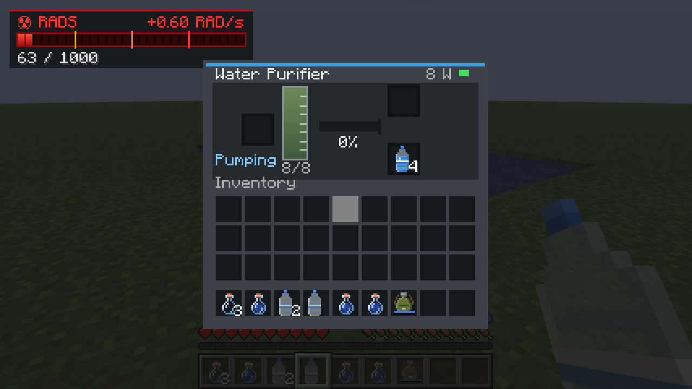

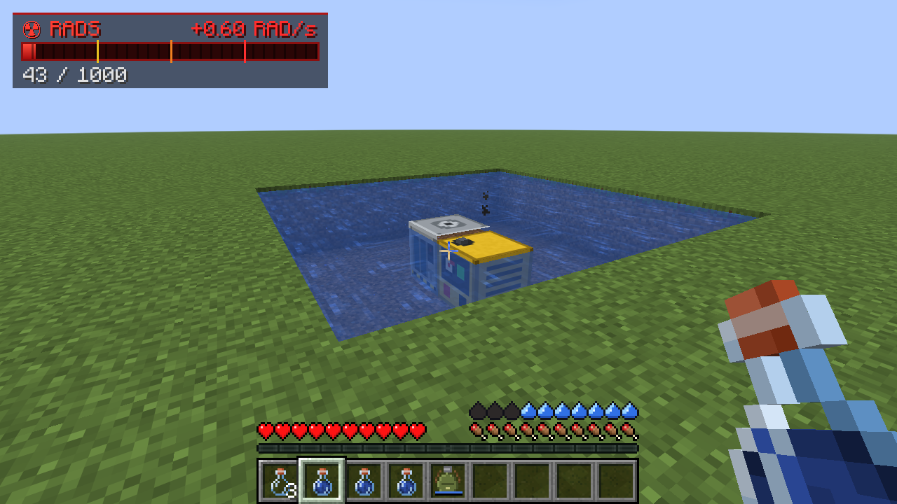

## Radioaktive Wolken, Wind und Regen

Seit 1.5.0 kann Radioaktivität wandern: Ein brennender Reaktorkern ([Fission](https://github.com/Lamisator/fission)),
eine Kernwaffendetonation ([RedButton](https://github.com/Lamisator/mc_redbutton)) oder ein Operator mit
`/radiation cloud <pos> <rad/s> [radius] [altitude]` setzt eine **radioaktive Wolke** frei. Sie steigt hoch in den Himmel
(standardmäßig 110 Blöcke über dem Boden, bei einer Kernwaffendetonation bis zu 375; während sie treibt, steigt sie um
weitere 80) und treibt mit dem Wind, wobei sie sich ausbreitet. Der Boden darunter bekommt ihre Strahlung ab (Leute in
Gebäuden werden von ihren Dächern abgeschirmt), und sie hinterlässt **Fallout** im Boden und in Seen und Flüssen (siehe
[Verstrahlter Boden und verstrahltes Wasser](#verstrahlter-boden-und-verstrahltes-wasser)): Er klingt ab wie Iod-131
(Halbwertszeit 8 Tage), bis auf etwa 15 %, die länger bleiben, wie Caesium-137 (hier Halbwertszeit 20 Tage).

**Seit 1.9.0 klingt alles vollständig ab.** Eine Wolke wandert **höchstens 2.000 Blöcke** (`clouds.maxTravelBlocks`);
auf ihren letzten 500 Blöcken dünnt sie zu nichts aus, und sie ist spätestens nach 40 Minuten verschwunden, oder früher,
wenn sie sich zu dünn verteilt hat. Fallout ist **40 Minecraft-Tage** nach der Landung vollständig verschwunden
(`clouds.falloutLifetimeDays`); im letzten Fünftel dieser Zeit klingt er auf null ab. Auch der **Ground Zero** einer
Kernwaffendetonation ([RedButton](https://github.com/Lamisator/mc_redbutton)) klingt ab: Vor 1.9.0 blieb er für immer.
Seit 1.9.1 gilt: **je kleiner der Sprengkopf, desto früher** (`clouds.groundZeroDays`):

| Sprengkopf | Ground Zero verschwunden nach | Halbwertszeit |
|---|---|---|
| Taktisch | 1 Tag | 0,2 Tage |
| Kernspaltung | 5 Tagen | 1 Tag |
| Thermonuklear | 15 Tagen | 3 Tage |
| Zar | 40 Tagen | 8 Tage |
| Fusionspuls (seit 1.9.3) | 3 Tagen | 0,6 Tage |

In einem Test ging ein taktischer Ground Zero von 30 rad/s nach einem Fünftel Tag auf 15, nach vier Fünfteln auf 3 und
nach einem Tag auf nichts; der einer Zar-Bombe lag noch bei 229 von 250 rad/s. Quellen aus älteren Welten werden beim
Laden der Welt umgewandelt. Was die Strahlung in Nahrung und Feldfrüchten hinterlassen hat, bleibt (siehe oben).

**Seit 1.6.0 verstrahlen Wolken viel stärker** (alles in der Konfiguration, `clouds`): Eine Wolke breitet sich halb so
schnell aus und hinterlässt fünfmal so viel Fallout. In einem Test war eine Wolke mit 3 rad/s (Wind 10 m/s) bei trockenem
Wetter 490 Blöcke windabwärts noch 1,2 rad/s stark und hinterließ eine Falloutspur von bis zu 25 rad/s; dieselbe Wolke
wurde im Regen innerhalb von 500 Blöcken auf 0,1 rad/s ausgewaschen und hinterließ Fallout von bis zu 85 rad/s dort, wo sie
ausregnete. Fallout landet auch dort auf dem Boden, wo niemand in der Nähe ist (1.5 konnte ihn in der Starthöhe der Wolke
hängen lassen).

**Regen wäscht Wolken aus.** Wo es unter einer Wolke regnet (oder schneit), lässt sie ihren Fallout viermal so oft und
pro Block fünfmal so stark fallen (`clouds.rainFactor`), sodass sie nach ein paar hundert Blöcken verschwunden ist - und
dort, wo es regnete, Hotspots hinterlässt, wie der Fallout von Tschernobyl. In einem Test, zwei gleiche Wolken nach 200
Blöcken: Unter der trockenen noch 1,5 rad/s, ihr heißester Fallout 5 rad/s; die im Regen 0,5 rad/s, ihr Fallout bis zu 14 rad/s.

**Der Wind** hat in Minecraft keine Entsprechung, er ist also ausgedacht, für alle gleich: Jede Welt hat eine
vorherrschende Richtung (aus ihrem Seed), die über die Tage hin und her schwankt, 3 bis 6 m/s, mehr bei Regen und Gewitter.
`/wind` sagt allen, wohin er weht. Clients zeichnen Wolken (und Rauchsäulen, etwa die eines brennenden Reaktors) bis zu
einem Kilometer weit, innerhalb ihrer Sichtweite.

## Befehle

`/rads` funktioniert für jeden Spieler und zeigt deine eigenen Rad und deinen Zustand. `/geiger [on | off | volume <percent>]`
(seit 1.10.2, funktioniert auf jedem Server, da es auf deinem eigenen Client läuft) schaltet das Geigerknacken der Umgebung
ein oder aus oder stellt seine Lautstärke ein: standardmäßig 30 % des ursprünglichen Knackens, gespeichert in
`config/radiation-client.json`.

Die übrigen brauchen Operatorrechte (oder aktivierte Cheats im Einzelspieler):

| Befehl | Beschreibung |
|---------|-------------|
| `/radiation zone add <name> <from> <to> <rads/s> [fade]` | Quaderförmiger Bereich mit gleichmäßiger Strahlung. `fade` lässt sie über so viele Blöcke vom Rand her ansteigen. |
| `/radiation source add <name> <pos> <rads/s> <radius> [falloff] [shielded]` | Punktquelle, die mit der Entfernung schwächer wird. Abfall: `linear` (Standard), `quadratic`, `inverse_square`, `constant`. `shielded` (Standard `true`) legt fest, ob Wände sie abschirmen. |
| `/radiation zone remove <name>` / `/radiation source remove <name>` | Eine Zone oder Quelle entfernen (Namen per Tab ergänzbar) |
| `/radiation list` (oder `zone list` / `source list`) | Alles auflisten |
| `/radiation show [seconds]` | Zeichnet Zonen (grün), Quellen (rot) und Fässer (gelb) mit Partikeln. `0` schaltet es ab. |
| `/radiation check [pos]` | Strahlung an einer Position, aufgeschlüsselt nach Zone/Quelle |
| `/radiation contamination [radius]` | Verstrahlter Boden und verstrahltes Wasser in deiner Nähe (seit 1.10.0); `add <pos> <rad/s>`, `clear <radius>` |
| `/radiation benchmark [radius]` | Dosisleistungen auf einem 8-Block-Raster um dich herum (standardmäßig 128 Blöcke), berechnet wie auf dem Server (strahlende Blöcke in Gruppen) und Block für Block: die Zeit für beides und die größte Abweichung |
| `/radiation get <player>` | Die Rad eines Spielers anzeigen |
| `/radiation set <players> <amount>` / `add <players> <amount>` | Rad ändern (negatives `add` zieht ab) |
| `/radiation clear [players]` | Rad auf 0 zurücksetzen |
| `/radiation thirst <players> [points]` | Den Durst eines Spielers anzeigen (0-20) oder setzen (seit 1.11.0) |
| `/radiation reload` | Konfiguration und Quellendatei neu laden |
| `/radiation cloud <pos> <rads/s> [radius] [altitude]` | Eine radioaktive Wolke freisetzen (standardmäßig 12 Blöcke breit, 110 hoch) |
| `/radiation clouds` | Die Wolken, die unterwegs sind, und ob sie ausregnen |
| `/radiation wind [set <towards°> <m/s> \| natural]` | Den Wind anzeigen, festlegen (0° = Norden, 90° = Osten) oder wieder frei wechseln lassen |
| `/wind` | Wohin der Wind weht (für alle) |

Beispiele:

```
/radiation zone add crater 100 50 100 160 90 160 15 5
/radiation source add reactor ~ ~1 ~ 40 20 quadratic
/radiation show 60
```

Zonen und Quellen werden pro Welt in `<world folder>/radiation_sources.json` gespeichert. Du kannst diese Datei auch
von Hand bearbeiten und danach `/radiation reload` ausführen.

## Konfiguration

Jeder Wert ist einstellbar. Die Dateien werden beim ersten Start im `config`-Ordner der Instanz angelegt.
In Prism ist das **Edit → Minecraft folder → config**.

**`config/radiation.json`**: Spielmechanik (auf einem Server gilt die Kopie des Servers). Dateien älterer Versionen werden
beim Laden aktualisiert; 1.8.0 leert `food.notContaminating`, wenn es noch die alte Standardliste enthält, und 1.9.0 setzt
`clouds.maxAgeMinutes` von den alten 120 auf 40.

| Einstellung | Standard | |
|---------|---------|-|
| `maxRads` | 1000 | Rad, bei denen du stirbst. Die Skala des Messers. |
| `stages` | 250 / 500 / 750 | Liste der Stufen: `threshold`, `name`, `color` (ARGB hex), `maxHealthModifier` (halbe Herzen), `effects` (jede Effekt-ID + `amplifier`, 0 = Stufe I). Beliebig hinzufügen, entfernen oder umbenennen. Die drei Standardnamen werden im Spiel übersetzt, eigene Namen erscheinen so, wie sie hier stehen. |
| `naturalDecayPerSecond` | 0 | Rad, die ohne Behandlung pro Sekunde verloren gehen |
| `updateIntervalTicks` | 10 | Wie oft die Strahlung berechnet wird (20 = einmal pro Sekunde) |
| `affectCreativeAndSpectator` | false | |
| `shieldingPerBlock` | 0.35 | Anteil, den jeder feste Block zwischen einer Punktquelle und dir wegnimmt |
| `concreteShielding`, `heavyShielding`, `waterShielding` | 0.90, 0.97, 0.30 | Dasselbe für Beton, schwere Abschirmung und Wasser. Dateien älterer Versionen mit den alten Standardwerten (0.55, 0.75) werden beim Laden aktualisiert; von Hand geänderte Werte bleiben. |
| `barrelRads`, `barrelRadius` | 6, 6 | Stärke des Atommüllfasses |
| `protectiveItems` | Schutzanzugteile mit 0.225 | Beliebige Item-ID → Schutz, wenn getragen. Hier kannst du Rüstungen anderer Mods eintragen. |
| `radXResistance` | 0.5 | |
| `maxProtection` | 0.95 | Auf 1.0 setzen, um volle Immunität zu erlauben |
| `radAwayTotalRads` | 150 | |
| `radAwayDurationSeconds`, `radXDurationSeconds` | 10, 240 | Brauchen einen Neustart |
| `requireGeigerCounter` | false | Wenn true, funktionieren die RAD/s-Anzeige und das Knacken nur, solange du einen Geigerzähler dabeihast |
| `ecology.enabled` | true | Strahlung verändert das Land (siehe oben) |
| `ecology.cropSlowdownRads`, `ecology.cropGrowthAtSlowdown` | 0.01, 0.5 | Ab dieser Rate wachsen Feldfrüchte mit diesem Bruchteil ihrer Geschwindigkeit... |
| `ecology.cropStuntRads`, `ecology.cropGrowthWhenStunted` | 0.1, 0.1 | ...und ab dieser Rate mit diesem Bruchteil |
| `ecology.leafDeathRads` | 0.3 | Laub stirbt ab |
| `ecology.plantDeathRads` | 1.0 | Feldfrüchte, Blumen, Gras, Farne und Setzlinge sterben ab |
| `ecology.grassToDirtRads` | 2.0 | Gras, Podsol, Moos und Ackerboden werden zu Erde |
| `ecology.soilToSandRads` | 25.0 | Erde wird zu Sand |
| `ecology.animalsTakeRads` | true | Tiere und Dorfbewohner nehmen Rad genau wie Spieler auf (ab 0,01 rad/s): dieselben Krankheitsstufen und Wirkungen, derselbe Anteil ihrer Gesundheit geht verloren, Tod bei `maxRads` |
| `food.enabled` | true | Nahrung trägt Kontamination, und sie zu essen gibt Rad |
| `food.cropUptake` | 20 | Rad pro geerntetem Stück für jedes rad/s an der Pflanze |
| `food.animalShare` | 0.1 | Anteil der Rad eines Tiers in jedem Stück Fleisch (Ei...), das es gibt |
| `food.storageUptake` | 0.005 | Rad pro Stück für jedes Rad Belastung in einem Behälter oder auf dem Boden |
| `food.storageIntervalTicks` | 100 | Wie oft gelagerte Nahrung betrachtet wird |
| `food.notContaminating` | (leer) | Punktquellen (nach Namensanfang), deren Strahlung nicht in Nahrung gelangt, z. B. `radioactive_cloud`, `fission_cloud`, `fission_release` |
| `food.gammaContaminates` | true | Ob strahlende Blöcke (Corium, abgebrannter Brennstoff) und Atommüllfässer Nahrung ebenfalls verstrahlen |
| `food.radsPerNutrition` | 4 | Das Höchste, was eine Nahrung pro Nährwertpunkt trägt (Brot: 20 Rad); 0 für keine Obergrenze |
| `clouds.maxAgeMinutes` | 40 | Wie lange eine radioaktive Wolke höchstens treibt |
| `clouds.maxTravelBlocks` | 2000 | Wie weit eine Wolke höchstens wandert; auf dem letzten Viertel dünnt sie aus |
| `clouds.falloutLongHalfLifeDays` | 20 | Halbwertszeit des langlebigen Anteils im Fallout (beim Ground Zero höchstens die Hälfte seiner Lebensdauer) |
| `clouds.falloutLifetimeDays` | 40 | Nach so vielen Tagen ist Fallout vollständig verschwunden |
| `clouds.groundZeroDays` | tactical 1, fission 5, thermonuclear 15, tsar 40, fusion 3 | Nach so vielen Tagen ist der Ground Zero einer Kernwaffendetonation verschwunden, je Sprengkopf; die Halbwertszeiten skalieren mit |
| `clouds.spreadPerBlock` | 0.012 | Wie viel breiter sie pro Block wird (breiter = dünner); 1.5 hatte 0.025 |
| `clouds.fadedRads` | 0.001 | Eine Wolke ist verschwunden, wenn die Dosisleistung unter ihr darunter fällt |
| `clouds.falloutFactor` | 5.0 | Aller Fallout wird damit multipliziert (1 = wie in 1.5) |
| `clouds.rainFactor` | 5.0 | Regen: so viel Mal mehr Fallout pro Block |
| `clouds.rainWashout` | 20.0 | Regen: Die Wolke wird pro Block so viel Mal schneller aufgebraucht |
| `ecology.intervalTicks`, `ecology.samplesPerChunk`, `ecology.changeChance` | 20, 4, 0.5 | Wie oft, wie viele Oberflächenblöcke pro Chunk in der Nähe von Strahlung und die Chance, dass sich ein Block über einer Schwelle jedes Mal ändert: höher ist schneller |
| `contamination.lastingHalfLifeDays` | 3650 | Halbwertszeit dauerhafter Kontamination (verschüttete Spaltprodukte) |
| `contamination.sprayWashes`, `contamination.sprayRadius`, `contamination.sprayerTank` | 0.25, 2.5, 32 | Anteil, der pro Stoß abgewaschen wird, seine Reichweite in Blöcken, Stöße pro Füllung |
| `contamination.runoffToWater` | 0.3 | Anteil des Abgewaschenen, der ins nächste Wasser läuft |
| `contamination.waterMixing` | 0.1 | Anteil seines Überschusses, den ein Wasserfeld alle 20 Sekunden an jeden Nachbarn abgibt |
| `contamination.swallowedFactor` | 1.0 | Tauchen: Die Dosisleistung des Wassers zählt so viel noch einmal |
| `thirst.enabled` | true | Durst und die Durstleiste (seit 1.11.0) |
| `thirst.idleSecondsPerPoint`, `thirst.exhaustionPerPoint`, `thirst.hotBiomeFactor` | 90, 6, 1.5 | Sekunden pro Punkt beim Nichtstun; Vanilla-Nahrungserschöpfung pro Punkt; wie viel schneller in heißen Biomen |
| `thirst.sprintThreshold`, `thirst.damage`, `thirst.damageIntervalSeconds` | 6, 1, 4 | Ab diesem Wert und darunter kein Sprinten; Schaden bei Austrocknung und wie oft |
| `thirst.servingPoints`, `thirst.canteenServings`, `thirst.sipPoints` | 6, 5, 2 | Punkte pro Flaschen- oder Feldflaschenportion, Portionen pro Feldflasche, Punkte pro Schluck aus einem Wasserblock |
| `thirst.waterUptake`, `thirst.maxRadsPerServing` | 10, 50 | Rad pro Portion für jedes rad/s dort, wo das Wasser geschöpft wurde, und das Höchste, was eine Portion trägt |
| `purifier.watts`, `purifier.standbyWatts` | 300, 8 | Leistung des Aufbereiters bei der Arbeit und im Leerlauf (230 V, Gridworks) |
| `purifier.secondsPerServing`, `purifier.pumpSecondsPerServing`, `purifier.tankServings` | 1.5, 0.3, 8 | Sekunden pro Portion bei voller Leistung, Sekunden, um eine aus einem Wasserblock zu pumpen, Tankgröße |
| `purifier.requireGridPower` | true | Ob der Aufbereiter bei installiertem Gridworks Netzstrom braucht |
| `ecology.tickBudgetMillis` | 5 | Serverzeit pro Tick für Land, Tiere und gelagerte Nahrung (seit 1.9.4); ein Durchlauf, der mehr braucht, geht in den nächsten Ticks weiter |

**`config/radiation-client.json`**: Anzeigeeinstellungen pro Spieler:

| Einstellung | Standard | |
|---------|---------|-|
| `hudX`, `hudY`, `hudScale` | 6, 6, 1.0 | Position und Größe des Messers |
| `hudMode` | `EXPOSURE` | `EXPOSURE` (wie in Fallout), `NONZERO` (immer, wenn du Rad hast), `ALWAYS`, `HIDDEN` |
| `hudLingerSeconds` | 4 | Wie lange der Messer nach Ende der Belastung bleibt |
| `showWhileHoldingGeiger` | true | |
| `geigerSound`, `geigerVolumePercent` | true, 30 | Das Geigerknacken der Umgebung, solange Strahlung dich erreicht: an/aus und seine Lautstärke in Prozent des ursprünglichen Knackens (seit 1.10.2; vorher immer 100 %). Im Spiel: `/geiger volume <0-200>`, `/geiger off`, `/geiger on`, `/geiger` zeigt die Einstellung. Ein altes `geigerVolume` wird umgerechnet. |
| `geigerClicksPerRad`, `geigerMaxClicksPerSecond` | 2.5, 60 | Wie geschäftig der Geigerzähler klingt |

## Leistung

**1.12.0 behebt einen Fehler von 1.9.4 - 1.11.0:** Nach jedem Serverstart begann der Durchlauf über Land, Tiere und
gelagerte Nahrung nie (ein „noch nie erledigt“-Zeitstempel lief in einer Subtraktion über), also wuchsen Feldfrüchte im
Fallout weiter, Tiere nahmen keine Rad auf, gelagerte Nahrung nahm nichts auf, und verstrahltes Wasser breitete sich nicht
aus. Er läuft wieder.

Seit 1.9.4 legt ein geschmolzener Reaktor den Server nicht mehr lahm. Vorher ließ ein zerstörter 1000-MW-Kern (etwa 2.300
strahlende Trümmer-, Corium- und Brennstoffblöcke) jede Dosisleistung eine Linie durch die Blöcke zu jedem von ihnen
ziehen, und der Durchlauf über Land, Tiere und gelagerte Nahrung dauerte jedes Mal 10-17 Sekunden, jede halbe Minute. Jetzt:

- **Strahlende Blöcke werden gruppiert**, in 32er- und 8er-Zellen. Eine Gruppe, die weiter als 48 (bzw. 12) Blöcke entfernt
  ist, bekommt eine Abschirmungslinie von ihrem nach Stärke gewichteten Mittelpunkt; jeder Block zählt weiterhin mit seiner
  eigenen Stärke und Entfernung. In deiner Nähe behält jeder Block seine eigene Linie. `/radiation benchmark` vergleicht das
  mit der Summe Block für Block: Beim zerstörten Kraftwerk von Funkstadt stimmen beide auf 0,0 % überein, etwa 20-mal schneller.
- **Abschirmungslinien** lesen die Chunk-Abschnitte direkt und merken sich, wie viel jeder Blockzustand schluckt.
- **Der Durchlauf hat ein Zeitbudget** (`ecology.tickBudgetMillis`, 5 ms pro Tick) und geht in den nächsten Ticks weiter.
- **Tiere und gelagerte Nahrung nutzen die zwischengespeicherten Dosisleistungen** des Landes (pro 4x4-Zelle und Höhe),
  und eine Truhe ohne Nahrung kostet nichts.

## Für Mod-Entwickler

Andere Mods können `dev.radiation.api.RadiationApi` (serverseitig) nutzen, um Punktquellen hinzuzufügen und zu entfernen, die Strahlung an einer Position zu lesen und Spielern Rad hinzuzufügen, mit oder ohne ihren Schutz. [RedButton](https://github.com/Lamisator/mc_redbutton) nutzt das, um nach Kernwaffendetonationen den Ground Zero zu bestrahlen.

Seit 1.3.0 lässt `setEmitter(level, pos, radsAtOneMetre, radius)` einen Block strahlen: Seine Stärke auf einen Meter fällt
mit dem Quadrat der Entfernung ab und wird von den Blöcken dazwischen geschluckt. Strahler werden mit der Welt gespeichert und
entfallen, wenn sich ihr Block ändert. `transmission(level, from, to)` gibt den Anteil an, der zwischen zwei Punkten durchkommt.
[Fission](https://github.com/Lamisator/fission) nutzt das für Reaktorkerne, abgebrannten Brennstoff, Lager und Corium.

Seit 1.5.0 setzt `releaseCloud(level, pos, strength, radius, altitude)` eine radioaktive Wolke frei (siehe oben),
`smokeColumn(level, key, foot, width, height, ticks)` zeigt eine Rauchsäule, und `wind(level)` liefert den Wind.

Seit 1.4.0 können Punktquellen zerfallen: `addSource(..., halfLifeTicks, longLivedFraction)` erzeugt eine Quelle, die sich
alle `halfLifeTicks` Spielticks halbiert, bis auf einen Anteil, der bleibt (Fallout: Iod klingt ab, Caesium bleibt), und die
sich selbst entfernt, sobald sie bei nichts angekommen ist. `updateSource(level, name, pos, rads, radius)` verschiebt eine
Quelle, z. B. eine treibende Wolke. Die radioaktiven Wolken und der Fallout von Fission nutzen beides. Seit 1.9.0 bekommen
Quellen namens `nuke_...` (der Ground Zero von RedButton) von selbst eine Halbwertszeit und Lebensdauer, aus
`clouds.groundZeroDays` für den Sprengkopf in ihrem Namen.

Seit 1.10.0 lässt `pulse(level, key, pos, radsAtOneMetre, radius, ticks)` etwas eine Weile strahlen, das kein Block ist (ein
Gegenstand auf dem Boden, ein Behälter auf einem Wagen): Erneuere es alle paar Sekunden unter demselben Schlüssel, es
erlischt von selbst. `contaminate(level, surface, rads)` fügt dem Feld bei `surface` (dem Luftblock über dem Boden oder dem
Wasser dort) dauerhafte Kontamination hinzu, `contaminationAt(level, surface)` liest sie, und `wash(level, surface, radius, share)`
wäscht sie ab. Fission 1.5.0 nutzt sie für Spaltprodukte, die herumliegen oder dort aufbewahrt werden, wo sie nicht hingehören.

## Aus dem Quellcode bauen

Braucht JDK 25.

```
./gradlew build
```

Die Mod-Jar landet in `build/libs/radiation-1.11.0.jar`. `./gradlew runClient` startet einen Entwicklungs-Client
mit geladener Mod. `./gradlew runClientGameTest` führt die Screenshot-Tour durch den Bunker aus,
`./gradlew runClientGameTest -Pscene=ecology` den Test für Land, Feldfrüchte und Abschirmung.
`./gradlew runClientGameTest -Pscene=food` den Test für verstrahlte Nahrung (Ernte, Brot, Fleisch, Ofen, Lager, Essen, Tooltips).

`tools/gen_assets.py` erzeugt die Texturen und Geräusche neu (braucht Pillow, numpy und soundfile, dazu
die aus der Jar des Minecraft-Clients entpackten Vanilla-Texturen).
